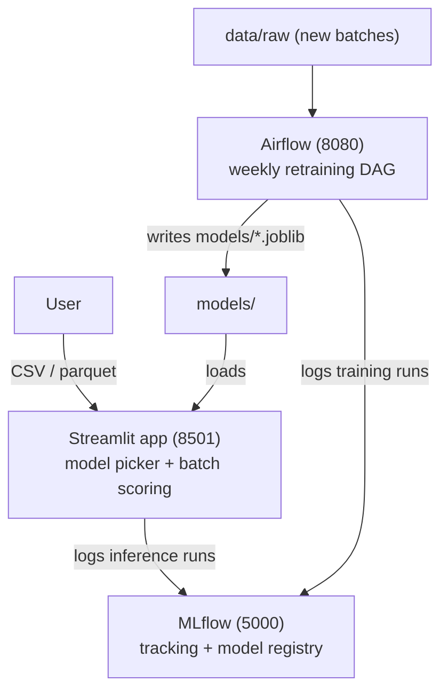

<h1 align="center">Car Insurance Claim Risk Prediction</h1>

<p align="center">
  Predicting which car insurance policies will file a claim in the next 6 months,<br/>
  with an end-to-end MLOps stack: <b>Streamlit</b> · <b>MLflow</b> · <b>Airflow</b> · <b>Docker</b>
</p>

<p align="center">
  
  
  
  
  
  
  
  
</p>

<p align="center">
  
  
  
  
  
</p>

<p align="center">
  <a href="LICENSE"></a>
  <a href="https://www.kaggle.com/datasets/ifteshanajnin/carinsuranceclaimprediction-classification"></a>
  <a href="https://cookiecutter-data-science.drivendata.org/"></a>
  
</p>

---

## Table of contents

- [Business problem](#business-problem)
- [Key results](#key-results)
- [EDA insights](#eda-insights)
- [Production models (trees / boosting)](#production-models-trees--boosting)
- [Statistical approach (GLM / Poisson)](#statistical-approach-glm--poisson)
- [MLOps architecture](#mlops-architecture)
- [Getting started](#getting-started)
- [Project organization](#project-organization)

## Business problem

At policy issuance and renewal, an auto insurer needs to know how likely each policyholder is to file a claim in the next 6 months. The score supports risk-based pricing, prioritizes policies for manual review and fraud-risk triage, and helps lower the loss ratio without turning away good customers.

The dataset has **58,592 policies** and **44 columns** (policyholder profile, vehicle specs and the binary target `is_claim`). It is heavily imbalanced: only **6.4%** of policies file a claim.

## Key results

- **Best production model:** HistGradientBoosting, ROC-AUC **0.649** and PR-AUC **0.107** on validation (base rate 0.064), served through the Streamlit app alongside 11 other models.
- **Interpretable baseline:** 5 GLMs (Poisson, Binomial logit/probit/cloglog, Negative Binomial) built with a leakage-free protocol. They reach a cross-validated ROC-AUC of **0.610** and translate risk into business terms (incidence rate ratios).
- **Claims are hard to predict:** no single variable correlates strongly with the target. Policy tenure is the strongest signal, with long-tenure policies claiming at more than twice the rate of very short ones.
- **Full MLOps loop:** batch scoring in Streamlit, experiment tracking and model registry in MLflow, weekly retraining in Airflow, all running on Docker Compose.

A full report (in Portuguese) is available in [`doc/car_insurance_claim_report.pdf`](doc/car_insurance_claim_report.pdf).

## EDA insights

| | |
|---|---|
|  | **Rare, imbalanced target.** Only 6.4% of policies (3,748 of 58,592) file a claim within 6 months, so every model has to handle the imbalance (`class_weight="balanced"`, PR-AUC and recall instead of raw accuracy). |
|  | **Nothing correlates strongly with the target.** `policy_tenure` has the highest correlation with `is_claim` (+0.08), and it is still weak. The ~13 vehicle size/engine variables (`displacement`, `length`, `width`, `gross_weight`...) are highly correlated **with each other** (up to 0.96) but close to 0 with the target: risk is not about the size of the car. |
|  | **Policy tenure is the strongest signal.** "Long" and "very long" policies claim at 8.3–8.7%, more than twice the rate of "very short" ones (3.6%). That is why `policy_tenure` is the main variable of the GLMs. |
|  | **Risk varies by region.** Clusters `C14`, `C4` and `C19` claim above 7.4% (vs. 6.4% for the whole portfolio), a candidate geographic underwriting factor. |
|  | **Safety features do not lower the raw claim rate.** Parking sensors, rear camera, brake assist, ESC and TPMS do not reduce (and sometimes slightly raise) the raw claim rate, so on their own they are poor risk predictors. |
|  | **Outliers capped by z-score.** Boxplots show long tails in `age_of_car`, `age_of_policyholder` and `population_density`; the treatment (`data/train_tratado_zscore.csv`) caps extremes at 3 standard deviations without dropping any policy. |

## Production models (trees / boosting)

`notebooks/model_ml.ipynb` trains and compares 10 models on the same label-encoded columns, and `notebooks/pipeline_ml.ipynb` tunes 2 HistGradientBoosting pipelines (`RandomizedSearchCV` / `GridSearchCV`). All production artifacts (`.joblib`) live in `models/`.

| Model | ROC-AUC | PR-AUC | Accuracy | F1 |
|---|---|---|---|---|
| HistGradientBoosting | 0.6493 | 0.1071 | 0.7796 | 0.1709 |
| CatBoost | 0.6476 | 0.1062 | 0.7794 | 0.1701 |
| Random Forest | 0.6417 | 0.1055 | 0.7779 | 0.1645 |
| Gradient Boosting | 0.6454 | 0.1040 | 0.7779 | 0.1645 |
| LightGBM | 0.6341 | 0.1018 | 0.7734 | 0.1477 |
| XGBoost | 0.6371 | 0.1008 | 0.7741 | 0.1501 |
| AdaBoost | 0.6369 | 0.1003 | 0.7766 | 0.1597 |
| Decision Tree | 0.6341 | 0.1000 | 0.7730 | 0.1461 |
| Extra Trees | 0.6199 | 0.0912 | 0.7707 | 0.1372 |
| Logistic Regression | 0.6125 | 0.0906 | 0.7732 | 0.1469 |

The default business threshold (`models/limiar_negocio.joblib`) is a **0.55** claim probability.

## Statistical approach (GLM / Poisson)

`notebooks/glm_poisson.ipynb` complements the tree models with 5 generalized linear models (via `statsmodels`), trading raw predictive power for interpretability (coefficients and incidence rate ratios):

1. **Poisson** (log link).
2. **Binomial – Logit** (classic logistic regression as a GLM).
3. **Binomial – Probit.**
4. **Binomial – Cloglog** (instead of Gamma, which requires a strictly positive response and cannot model a 0/1 target).
5. **Negative Binomial** (count model, alpha fixed at 1).

**Leakage-free protocol.** The 80/20 train/test split comes first. Outlier limits, correlations, dummy categories, feature selection and the decision threshold all come from the training set only; every choice is made by 5-fold cross-validation on the training set, and the test set is only reported. No new column is created in the dataset: the notebook only selects existing columns and encodes categorical and Yes/No columns as 0/1.

**Features.** `policy_tenure` (strongest positive correlation with the target), `age_of_policyholder`, `age_of_car` (negative correlation, but the second strongest signal; removing it hurts the model), `cylinder` and `is_parking_sensors` (vehicle variables with a positive correlation above 2/√n, no collinearity, and new information), plus `segment`, `transmission_type` and `area_cluster` (replacing `population_density`, which is unique per cluster).

| Model (test set) | ROC-AUC | PR-AUC | Recall | Precision | Flagged | ROC-AUC (CV) |
|---|---|---|---|---|---|---|
| Poisson | 0.5857 | 0.0863 | 0.552 | 0.080 | 44% | 0.6104 |
| Binomial – Logit | 0.5857 | 0.0864 | 0.552 | 0.080 | 44% | 0.6104 |
| Binomial – Probit | 0.5857 | 0.0862 | 0.549 | 0.080 | 44% | 0.6106 |
| Binomial – Cloglog | 0.5857 | 0.0863 | 0.552 | 0.080 | 44% | 0.6104 |
| Negative Binomial | 0.5856 | 0.0863 | 0.552 | 0.080 | 44% | 0.6104 |

**Before vs. after** (same protocol). The first version did not give `policy_tenure` to the 4 non-Poisson models. With that fixed, they go from ROC-AUC 0.546 → 0.610 in cross-validation and 0.555 → 0.586 on the test set (PR-AUC 0.074 → 0.086). The Poisson model, which already used `policy_tenure` as an offset, barely changes (test 0.586 → 0.586). The 5 families end up indistinguishable: with the same features, switching the family does not change the result.

**Where the GLM hits its limit.** A tree model (HistGradientBoosting) using **exactly the same columns** as the GLM reaches ~0.65 ROC-AUC, so the gap comes from the linear form, not from missing information. The clearest case is `age_of_car`: brand-new cars (age 0) have a ~10% claim rate versus 4.5–7% in the other age bands. Capturing that shape needs a new column, which the project's no-new-columns rule currently rules out.

The full before/after comparison is in `output/comparativo_glm.csv`.

## MLOps architecture



- **`car_insurance_claim/`** — Python package shared by every component: `modeling/predict.py` (inference: loads `models/`, applies the same `LabelEncoder`s used in training, maps unseen categories, applies the business threshold), `modeling/train.py` (retrains the 10 models and logs them to MLflow; called by Airflow) and `mlops/` (MLflow helpers, historical-metrics backfill and the PDF report generator).
- **`app/`** — Streamlit app: model picker (12 models), CSV/parquet upload, batch scoring with download, and a historical model-comparison tab.
- **`docker-compose.yml`** — Streamlit + MLflow (day-to-day use).
- **`docker-compose.airflow.yml`** — full Airflow (webserver + scheduler + Postgres), optional, only needed to train or retrain.
- **`airflow/dags/retrain_car_insurance_model_dag.py`** — weekly DAG that reads the newest batch in `data/raw` (falling back to `data/train.parquet` when empty), retrains the 10 models and logs everything to MLflow.

## Getting started

### Data

The data is not stored in this repository; it comes from the Kaggle dataset [`ifteshanajnin/carinsuranceclaimprediction-classification`](https://www.kaggle.com/datasets/ifteshanajnin/carinsuranceclaimprediction-classification). To download it, put your Kaggle credential in `config/kaggle.json` (the `config/` folder is git-ignored and must never be committed), set `base_dir` at the top of `src/data_kaggle.py`, and run:

```bash
python src/data_kaggle.py
```

The trained models (`models/*.joblib`) are in the repository, so the Streamlit app works without the data; the notebooks and the Airflow retraining need it.

### Run locally (without Docker)

```bash
pip install -r requirements.txt
pip install -e .
streamlit run app/streamlit_app.py
```

To get metrics and run logging in MLflow, start a local server first and point the app at it:

```bash
mlflow server --backend-store-uri sqlite:///mlflow/data/mlflow.db --default-artifact-root ./mlflow/artifacts --port 5000
export MLFLOW_TRACKING_URI=http://localhost:5000
```

### Run with Docker (recommended)

```bash
# Streamlit + MLflow — day-to-day use
docker compose up -d --build
```

Streamlit runs at http://localhost:8501 and MLflow at http://localhost:5000. The first time, fill the MLflow history with the already-trained models:

```bash
docker compose exec streamlit python -m car_insurance_claim.mlops.backfill
```

```bash
# Airflow (batch retraining) — optional, started separately
docker compose -f docker-compose.airflow.yml up -d --build
```

Airflow runs at http://localhost:8080 (user/password `admin`/`admin`). Turn on the `retrain_car_insurance_model` DAG in the UI, or trigger it with `airflow dags trigger`.

### Command line

```bash
# retrain the 10 models and log them to MLflow
python car_insurance_claim/modeling/train.py

# score a new batch
python car_insurance_claim/modeling/predict.py --input-path data/raw/new_batch.csv --model-name HistGradientBoosting

# rebuild the PDF report
python car_insurance_claim/mlops/generate_report.py
```

## Project organization

```
├── LICENSE
├── Makefile
├── README.md
├── app/                       <- Streamlit app (model picker, CSV upload, batch scoring)
│   ├── streamlit_app.py
│   └── requirements.txt
├── airflow/
│   ├── dags/retrain_car_insurance_model_dag.py
│   └── requirements-dag.txt
├── car_insurance_claim/       <- shared Python package (installable with `pip install -e .`)
│   ├── config.py              <- paths, MLflow tracking URI and experiment
│   ├── dataset.py / features.py / plots.py
│   ├── modeling/
│   │   ├── predict.py         <- inference contract used by Streamlit
│   │   └── train.py           <- retraining + MLflow logging, used by Airflow
│   └── mlops/
│       ├── mlflow_utils.py
│       ├── backfill.py        <- logs the already-trained models to MLflow
│       └── generate_report.py <- builds doc/car_insurance_claim_report.pdf
├── data/                      <- raw, interim, processed, external (not versioned)
├── doc/                       <- project report (PDF, in Portuguese)
├── docker/                    <- Dockerfiles (streamlit, mlflow, airflow)
├── docker-compose.yml         <- Streamlit + MLflow
├── docker-compose.airflow.yml <- Airflow + Postgres (optional)
├── docs/                      <- mkdocs
├── img/                       <- EDA and GLM charts
├── mlflow/                    <- MLflow server volumes (data/, artifacts/)
├── models/                    <- trained models (.joblib), encoders, business threshold
├── notebooks/
│   ├── analise_dados.ipynb    <- EDA and outlier treatment
│   ├── model_ml.ipynb         <- comparison of the 10 tree/boosting models
│   ├── pipeline_ml.ipynb      <- tuned HistGradientBoosting pipelines
│   └── glm_poisson.ipynb      <- 5 GLM/Poisson models (statistical approach)
├── output/                    <- results tables (resultados_modelos*.csv, comparativo_glm.csv)
├── src/                       <- Kaggle download scripts
├── pyproject.toml
├── requirements.txt
└── tests/
```

## License

Distributed under the MIT License. See [`LICENSE`](LICENSE).
