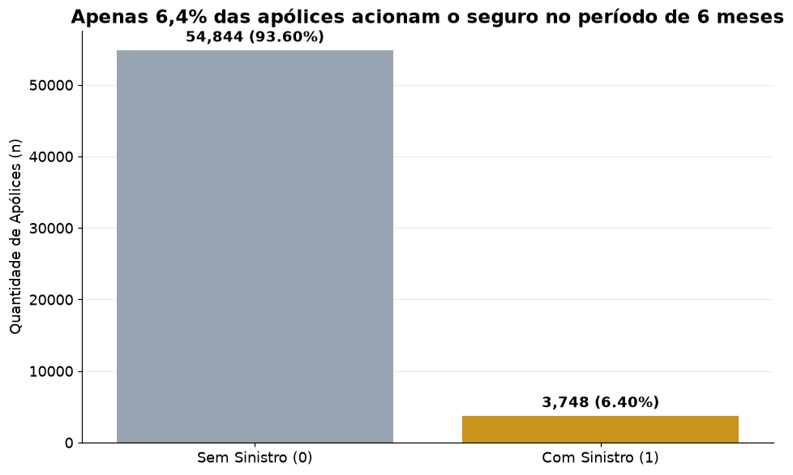
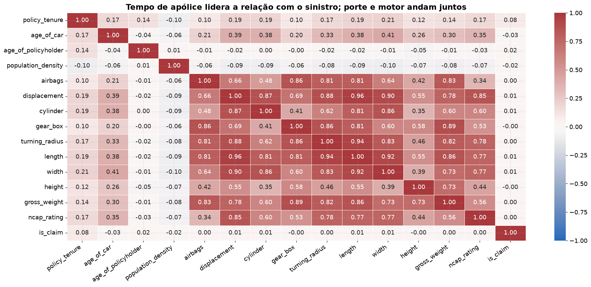
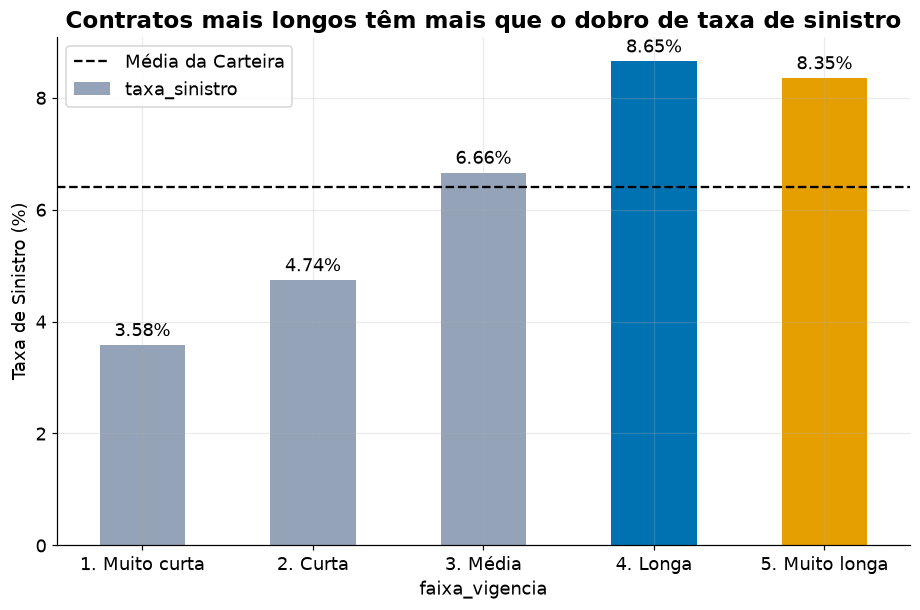
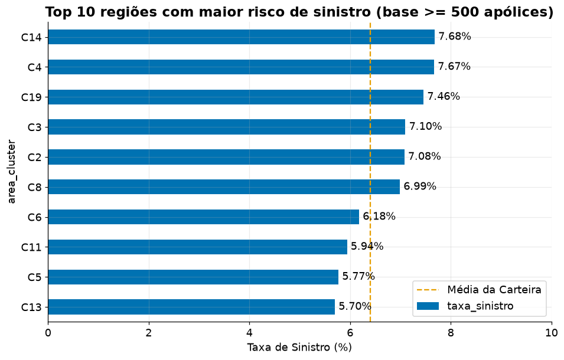
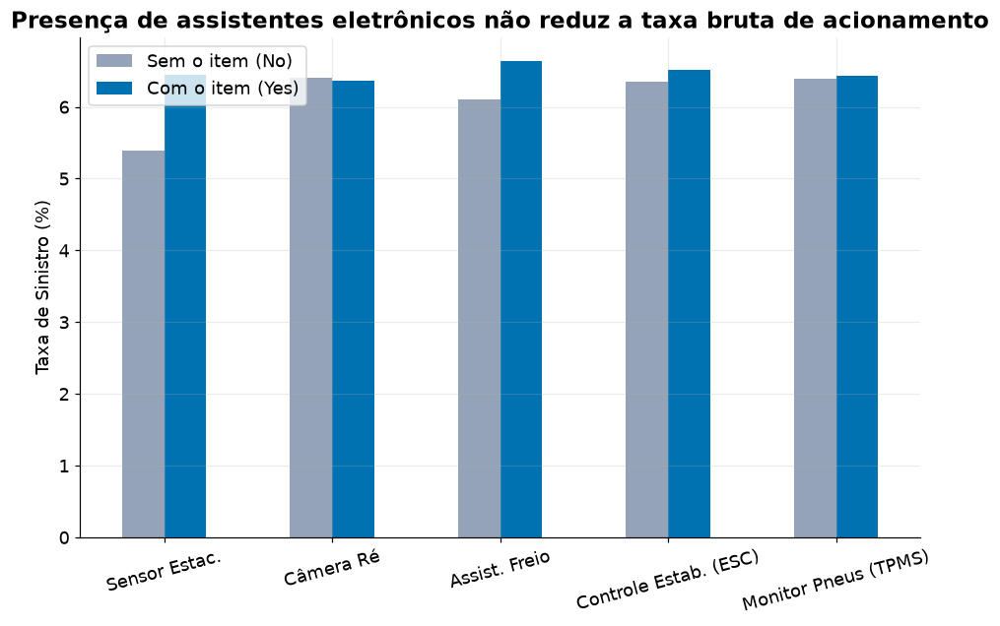
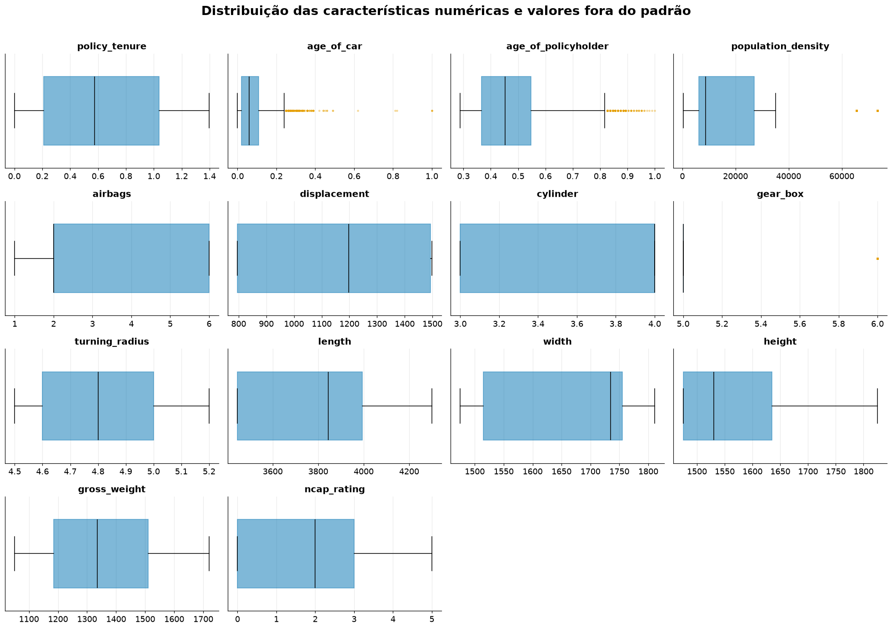

# Car Insurance Claim Risk Prediction

<a target="_blank" href="https://cookiecutter-data-science.drivendata.org/">
    
</a>

Previsão do risco de sinistro (`is_claim`) de apólices de seguro automotivo nos próximos 6 meses, com um stack completo de MLOps: app **Streamlit** para previsão em lote, **MLflow** para rastreio de métricas e ciclo de vida dos modelos, **Airflow** para retreinamento em batch, e tudo containerizado em **Docker**.

## Problema de negócio

Uma seguradora precisa decidir, na emissão e renovação da apólice, qual a probabilidade de cada segurado acionar o seguro nos próximos 6 meses. O score é usado para precificação baseada em risco, priorização de apólices para revisão manual/triagem de fraude e redução de sinistralidade sem rejeitar bons clientes. A base tem 58.592 apólices e 44 colunas (perfil do segurado, veículo e o alvo binário `is_claim`), com forte desbalanceamento: apenas **6,4%** das apólices acionam o seguro.

## Principais insights (EDA)

| | |
|---|---|
|  | **Alvo raro e desbalanceado.** Só 6,4% das apólices (3.748 de 58.592) acionam o seguro em 6 meses — qualquer modelo precisa lidar com essa assimetria (`class_weight="balanced"`, PR-AUC/recall em vez de acurácia bruta). |
|  | **Nada se correlaciona fortemente com o alvo.** `policy_tenure` (tempo de apólice) é a variável com maior correlação com `is_claim` (+0,08) — ainda assim fraca. As ~13 variáveis de porte/motor do veículo (`displacement`, `length`, `width`, `gross_weight`...) são fortemente correlacionadas **entre si** (até 0,96), mas quase 0 com o alvo: o risco não está no tamanho do carro. |
|  | **Tempo de apólice é o sinal mais forte.** Apólices "longas"/"muito longas" têm taxa de sinistro de 8,3–8,7%, mais que o dobro das "muito curtas" (3,6%) — por isso `policy_tenure` é a principal variável dos modelos GLM. |
|  | **Risco varia por região.** Os clusters `C14`, `C4` e `C19` têm taxa de sinistro acima de 7,4% (vs. 6,4% da carteira) — candidato a fator de underwriting geográfico. |
|  | **Itens de segurança não reduzem a taxa bruta.** Sensor de estacionamento, câmera de ré, assistente de freio, ESC e TPMS não diminuem (e às vezes aumentam ligeiramente) a taxa de sinistro bruta — não são, isoladamente, bons preditores de risco. |
|  | **Outliers tratados por z-score.** Boxplots mostram caudas longas em `age_of_car`, `age_of_policyholder` e `population_density`; o tratamento (`data/train_tratado_zscore.csv`) limita extremos a 3 desvios-padrão sem remover apólices. |

## Abordagem estatística (GLM / Poisson)

`notebooks/glm_poisson.ipynb` complementa os modelos de árvore/boosting com 5 modelos generalistas da família GLM (via `statsmodels`), buscando interpretabilidade (coeficientes, IRR) em vez de poder preditivo bruto:

1. **Poisson** (link log).
2. **Binomial — Logit** (regressão logística clássica como GLM).
3. **Binomial — Probit.**
4. **Binomial — Cloglog** (no lugar de Gamma, que exige resposta estritamente positiva e não aceita o alvo 0/1).
5. **Binomial Negativa** (modelo de contagem, alpha fixo em 1).

**Protocolo sem vazamento:** a divisão treino/teste (80/20) vem antes de tudo. Limites de outlier, correlações, categorias das dummies, escolha de variáveis e limiar de decisão vêm só do treino; as escolhas são feitas por validação cruzada 5-fold no treino e o teste só é reportado. Nenhuma coluna nova é criada na base — só seleção de colunas existentes e codificação 0/1 das categóricas e Sim/Não.

**Variáveis:** `policy_tenure` (maior correlação positiva com o alvo), `age_of_policyholder`, `age_of_car` (correlação negativa, mas é o 2º sinal mais forte — removê-la piora o modelo), `cylinder` e `is_parking_sensors` (variáveis do veículo com correlação positiva acima de 2/√n, sem colinearidade e que acrescentam informação), `segment`, `transmission_type` e `area_cluster` (no lugar de `population_density`, que é única por cluster).

| Modelo (teste) | ROC-AUC | PR-AUC | Recall | Precisão | Marca | ROC-AUC (CV) |
|---|---|---|---|---|---|---|
| Poisson | 0.5857 | 0.0863 | 0.552 | 0.080 | 44% | 0.6104 |
| Binomial – Logit | 0.5857 | 0.0864 | 0.552 | 0.080 | 44% | 0.6104 |
| Binomial – Probit | 0.5857 | 0.0862 | 0.549 | 0.080 | 44% | 0.6106 |
| Binomial – Cloglog | 0.5857 | 0.0863 | 0.552 | 0.080 | 44% | 0.6104 |
| Binomial Negativa | 0.5856 | 0.0863 | 0.552 | 0.080 | 44% | 0.6104 |

**Antes vs. depois** (mesmo protocolo): a versão inicial não dava `policy_tenure` aos 4 modelos não-Poisson. Corrigido isso, eles vão de ROC-AUC 0,546 → 0,610 na validação cruzada e 0,555 → 0,586 no teste (PR-AUC 0,074 → 0,086). O Poisson, que já usava `policy_tenure` como offset, praticamente não muda (teste 0,586 → 0,586). As 5 famílias ficam indistinguíveis: com as mesmas variáveis, trocar a família não muda o resultado.

**Limite:** uma árvore (HistGradientBoosting) com **as mesmas colunas** do GLM chega a ~0,65 de ROC-AUC — a diferença é a forma linear, não falta de informação. O caso mais claro é `age_of_car`: carros com idade 0 têm ~10% de sinistro, contra 4,5–7% nas outras faixas. Representar isso exige uma coluna nova, o que a regra do projeto hoje não permite.

Comparativo completo em `output/comparativo_glm.csv`.

## Modelos de produção (árvore/boosting)

`notebooks/model_ml.ipynb` treina e compara 10 modelos (mesmas colunas, label-encoded) + `notebooks/pipeline_ml.ipynb` ajusta 2 pipelines HistGradientBoosting tunados (`RandomizedSearchCV`/`GridSearchCV`). Os `.joblib` de produção ficam em `models/`.

| Modelo | ROC-AUC | PR-AUC | Acurácia | F1 |
|---|---|---|---|---|
| HistGradientBoosting | 0.6493 | 0.1071 | 0.7796 | 0.1709 |
| CatBoost | 0.6476 | 0.1062 | 0.7794 | 0.1701 |
| Random Forest | 0.6417 | 0.1055 | 0.7779 | 0.1645 |
| Gradient Boosting | 0.6454 | 0.1040 | 0.7779 | 0.1645 |
| LightGBM | 0.6341 | 0.1018 | 0.7734 | 0.1477 |
| XGBoost | 0.6371 | 0.1008 | 0.7741 | 0.1501 |
| AdaBoost | 0.6369 | 0.1003 | 0.7766 | 0.1597 |
| Decision Tree | 0.6341 | 0.1000 | 0.7730 | 0.1461 |
| Extra Trees | 0.6199 | 0.0912 | 0.7707 | 0.1372 |
| Logistic Regression | 0.6125 | 0.0906 | 0.7732 | 0.1469 |

O limiar de negócio padrão (`models/limiar_negocio.joblib`) é **0,55** de probabilidade de sinistro.

## Arquitetura MLOps

```
┌──────────────┐      CSV/parquet       ┌────────────────────┐
│   Usuário    │ ─────────────────────▶ │  Streamlit (8501)  │
└──────────────┘                        │  seleção de modelo │
                                         │  previsão em lote  │
                                         └──────────┬──────────┘
                                                    │ log de métricas/execuções
                                                    ▼
                                         ┌────────────────────┐
                                         │   MLflow (5000)    │
                                         │ tracking + registry │
                                         └──────────▲──────────┘
                                                    │ log de treino/retreino
                                         ┌──────────┴──────────┐
                                         │  Airflow (8080)     │
                                         │  DAG semanal:       │
                                         │  retreina os 10     │
                                         │  modelos a partir   │
                                         │  de data/raw        │
                                         └──────────────────────┘
```

- **`car_insurance_claim/`** — pacote compartilhado por todos os componentes: `modeling/predict.py` (inferência: carrega `models/`, aplica os mesmos `LabelEncoder`s do treino, mapeia categorias não vistas, aplica o limiar de negócio), `modeling/train.py` (retreino dos 10 modelos + log no MLflow, chamado pelo Airflow) e `mlops/` (utilitários de MLflow e backfill de métricas históricas).
- **`app/`** — Streamlit: seletor de modelo (12 disponíveis), upload de CSV/parquet, previsão em lote com download, aba de comparativo histórico dos modelos.
- **`docker-compose.yml`** — sobe Streamlit + MLflow (uso do dia a dia).
- **`docker-compose.airflow.yml`** — sobe Airflow completo (webserver + scheduler + Postgres), opcional, só quando for treinar/retreinar.
- **`airflow/dags/retrain_car_insurance_model_dag.py`** — DAG semanal que lê o lote mais recente em `data/raw` (ou volta para `data/train.parquet` se vazio), retreina os 10 modelos e loga tudo no MLflow.

## Como executar

### Dados

Os dados não ficam no repositório (vêm do dataset do Kaggle `ifteshanajnin/carinsuranceclaimprediction-classification`). Para baixá-los, coloque sua credencial em `config/kaggle.json` (a pasta `config/` está no `.gitignore` e nunca deve ser versionada), ajuste `base_dir` no topo de `src/data_kaggle.py` e rode:

```bash
python src/data_kaggle.py
```

Os modelos treinados (`models/*.joblib`) estão no repositório, então o app Streamlit funciona sem baixar os dados; os notebooks e o retreinamento pelo Airflow precisam deles.

### Localmente (sem Docker)

```bash
pip install -r requirements.txt
streamlit run app/streamlit_app.py
```

Para métricas/registro no MLflow, rode um servidor local antes (`mlflow server --backend-store-uri sqlite:///mlflow/data/mlflow.db --default-artifact-root ./mlflow/artifacts --port 5000`) e exporte `MLFLOW_TRACKING_URI=http://localhost:5000`.

### Via Docker (recomendado)

```bash
# app Streamlit + MLflow — uso do dia a dia
docker compose up -d --build
```
Streamlit em http://localhost:8501, MLflow em http://localhost:5000.

Na primeira vez, popule o histórico do MLflow com os modelos já treinados:
```bash
docker compose exec streamlit python -m car_insurance_claim.mlops.backfill
```

```bash
# Airflow (retreinamento em batch) — opcional, sobe à parte
docker compose -f docker-compose.airflow.yml up -d --build
```
Airflow em http://localhost:8080 (usuário/senha `admin`/`admin`). Ative o DAG `retrain_car_insurance_model` pela UI ou `airflow dags trigger`.

### Retreinar via linha de comando

```bash
python car_insurance_claim/modeling/train.py
python car_insurance_claim/modeling/predict.py --input-path data/raw/novo_lote.csv --model-name HistGradientBoosting
```

## Project Organization

```
├── LICENSE
├── Makefile
├── README.md
├── app/                      <- app Streamlit (seleção de modelo, upload CSV, previsão)
│   ├── streamlit_app.py
│   ├── requirements.txt
├── airflow/
│   ├── dags/retrain_car_insurance_model_dag.py
│   └── requirements-dag.txt
├── car_insurance_claim/      <- pacote Python compartilhado (instalável via `pip install -e .`)
│   ├── config.py             <- paths, MLflow tracking URI/experiment
│   ├── dataset.py / features.py / plots.py
│   ├── modeling/
│   │   ├── predict.py        <- contrato de inferência usado pelo Streamlit
│   │   └── train.py          <- retreino + log no MLflow, usado pelo Airflow
│   └── mlops/
│       ├── mlflow_utils.py
│       └── backfill.py       <- loga o histórico já treinado no MLflow
├── data/                     <- raw, interim, processed, external
├── doc/                      <- relatório do projeto em PDF
├── docker/                   <- Dockerfiles (streamlit, mlflow, airflow)
├── docker-compose.yml        <- Streamlit + MLflow
├── docker-compose.airflow.yml<- Airflow + Postgres (opcional)
├── docs/                     <- mkdocs
├── img/                      <- gráficos de EDA e do notebook GLM
├── mlflow/                   <- volumes do servidor MLflow (data/, artifacts/)
├── models/                   <- modelos treinados (.joblib), encoders, limiar de negócio
├── notebooks/
│   ├── analise_dados.ipynb   <- EDA e tratamento de outliers
│   ├── model_ml.ipynb        <- comparação dos 10 modelos de árvore/boosting
│   ├── pipeline_ml.ipynb     <- pipelines HistGradientBoosting tunados
│   └── glm_poisson.ipynb     <- 5 modelos GLM/Poisson (abordagem estatística)
├── output/                   <- tabelas de resultados (resultados_modelos*.csv)
├── pyproject.toml
├── requirements.txt
└── tests/
```

--------
